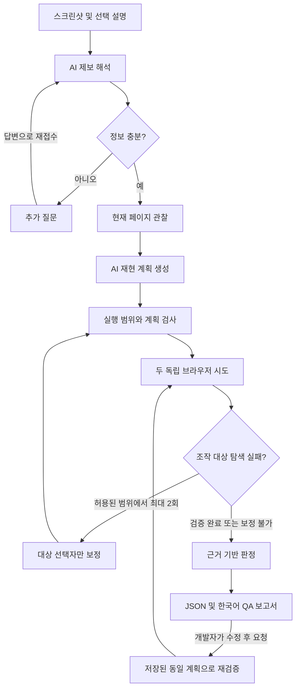

# Core_engine

team METAPHOR의 **스크린샷 기반 웹앱 자동 QA 엔진**입니다. 사용자가 스크린샷만 올리거나 설명을 함께 입력하면, AI가 문제 후보를 해석하고 브라우저 재현 계획을 만듭니다. 실제 실행 근거로 재현 여부를 판단하고 개발자가 검토할 QA 보고서를 제공합니다.

제품 범위는 **문제 파악·재현·검증·보고·수정 후 재검증**입니다. 고객 코드 수정, 패치 적용, PR 생성은 하지 않습니다. 기존 보안 취약점 분류는 일반 버그 유형으로 전환했습니다.

## 파이프라인



AI는 제보·화면을 해석하고 계획·보고서를 생성합니다. 엔진이 허용한 동작을 Playwright가 실행하며, 판정은 고정된 조건과 실제 관찰 기록으로 계산합니다. 매 동작 전후에 화면을 기록하고, 실패했을 때만 AI에 대상 재탐색을 요청합니다. 모든 클릭마다 모델을 호출하지는 않습니다.

## 구현 기능

| 영역 | 구현 |
|---|---|
| 스크린샷 입력 | PNG/JPEG/WebP 검증, 크기 제한, 메타데이터 제거, 지정 영역 마스킹, 이미지 모델 입력 |
| 제보 해석 | 화면에서 확인한 사실·가설·기대 동작 출처 구분, 정보 부족 시 질문 및 답변 후 재개 |
| 버그 분류 | 기능·시각·상호작용·콘텐츠·성능·호환성·검토 필요 |
| 재현 계획 | 현재 페이지의 요소와 스크린샷을 읽고 최대 20개 동작 생성 |
| 실행·재계획 | 두 독립 실행, 단계별 관찰, 실패한 동작의 선택자만 최대 2회 보정 |
| 검증 조건 | 텍스트, 표시 여부, 활성화, 요소 개수, 영역 겹침, 화면/요소 넘침 |
| 근거 | 화면, 정제된 요소 정보, 요청 URL·상태·차단 코드, 콘솔/페이지 오류, 단계·시각·계획 해시 |
| 보고 | 재현 결과, 임시 영향도, 원인 가설, 해결 방향, 검증 절차, 근거 참조 |
| 저장·연동 | 작업별 JSON/PNG/Markdown, 진행 이벤트, 추가 정보 응답·동일 계획 재검증 API |
| 실행 통제 | 원점·경로·DNS/IP 검사, 요청 수·용량·시간 제한, 취소·승인 철회, 모델 호출 수 제한 |

분류 가능한 유형과 자동으로 검증 가능한 동작은 다릅니다. 성능 문제처럼 현재 조건으로 표현할 수 없는 제보는 추가 정보를 요청하거나 판단을 보류합니다. AI 결과의 정확성은 실제 모델 평가와 사람의 검토가 필요합니다.

## 설치

Python 3.11 이상을 사용합니다. macOS/Linux 기준:

```bash
python3 -m venv .venv
source .venv/bin/activate
python -m pip install ".[browser]"
python -m playwright install chromium --only-shell
```

Linux에 브라우저 시스템 라이브러리가 없으면 `python -m playwright install --with-deps chromium --only-shell`을 사용합니다. 소스를 수정한 뒤에는 패키지를 다시 설치합니다. 소스 기준 테스트는 `PYTHONPATH=src`를 붙여 실행할 수도 있습니다.

## 키 없이 전체 QA 데모

```bash
python examples/qa_demo.py
python examples/qa_demo.py --repair --retest-fixed
```

실제 Chromium으로 합성 검색 화면의 스크린샷을 만든 뒤, **명시적인 고정 모델 응답**으로 제보 해석·계획 생성·브라우저 실행·보고서를 연결합니다. 고정 응답은 실제 AI 추론이나 모델 품질 평가가 아닙니다. 외부 AI API를 호출하지 않습니다.

두 번째 명령은 잘못된 버튼 ID를 현재 화면의 ID로 보정한 후 버그를 재현하고, 수정된 합성 화면에서 **같은 계획 해시**로 다시 검증합니다. `reproduced → not_reproduced`, `regression=resolved_in_test` 흐름을 확인할 수 있습니다. 예제만 수정된 빌드로 전환하며 QA 엔진은 앱 코드를 수정하지 않습니다.

기본 출력은 `.qa-results/<job_id>/`입니다. 콘솔에 보고서 경로와 판정이 표시됩니다. `report.md`와 함께 저장된 PNG를 유지하면 Markdown에서 근거 화면을 볼 수 있습니다. `--output PATH`로 위치를 지정합니다. 기존 `examples/demo.py`, `examples/analyze_report.py`도 개별 모듈 데모로 사용할 수 있습니다.

## 실제 이미지 AI 연동

서버 비밀정보 설정으로 `OPENAI_API_KEY`를 주입하고, `OPENAI_MODEL`에는 계정에서 사용할 수 있는 **이미지 입력 + Responses API + Structured Outputs 지원 모델 ID**를 설정합니다. `.env.example`은 이름 참고용이며 `.env` 자동 로딩은 하지 않습니다.

```bash
# API 키는 서버 비밀정보 설정으로 주입합니다.
export OPENAI_MODEL="YOUR_SUPPORTED_MODEL_ID"
python examples/qa_demo.py --live
```

로컬에서 직접 작성한 `.env`를 사용할 때는 저장소 루트에서 명시적으로 불러옵니다. `.env`는 Git에서 제외되며 키를 문서나 코드에 넣지 않습니다.

```bash
chmod 600 .env
set -a
source .env
set +a
python examples/qa_demo.py --live --retest-fixed
```

기본 작업은 해석·계획·보고에 3회, 선택자 보정 시 최대 2회가 추가됩니다. 기본 모델 호출 상한은 작업당 6회이며 자동 HTTP 재시도는 없습니다. 이미지도 과금 대상입니다. 응답 저장 옵션은 `store=false`이지만 공급자의 전체 보존 정책을 대신하지 않습니다.

유료 모델 호출은 자동 테스트에 포함하지 않습니다. 테스트는 프로토콜·흐름·실제 브라우저 결과를 검사하며, 모델의 분류 정확도·재현 계획 성공률·프롬프트 공격 저항성을 입증하지 않습니다.

## 작은 평가 세트와 자동 실행기

검색·필터·텍스트 잘림·버튼 겹침의 버그/정상 쌍 8건, 정보 부족 2건, 환경 장애 2건을 평가합니다. 실제 모델 결과는 모델이 만든 계획을 별도로 다시 실행하고 실제 조작 이력·화면 상태로 채점합니다.

```bash
# 키 없이 실행기 검증: AI 성능 점수가 아닙니다.
PYTHONPATH=src python -m core_engine.evaluation --repeats 1 --retest-fixed

# 환경변수 설정 후 실제 AI 평가: 12개 사례를 각 3회 실행합니다.
PYTHONPATH=src python -m core_engine.evaluation --live --repeats 3 --retest-fixed
```

한국어 결과표·JSON·CSV·화면 근거·시간·토큰 기록을 `.qa-evals/`에 저장합니다. 이 세트는 공개된 합성 개발용 사례입니다. 평가 대상, 호출 상한, 지표의 분모와 제한은 [평가 실행 명세](docs/qa-evaluation.md)를 참고하세요.

## 백엔드 호출

```python
from pathlib import Path
from core_engine import (
    BrowserOptions, JobStore, OpenAIModel, QARequest, QAService, RunPolicy, Screenshot,
)

policy = RunPolicy("project-1", 1, "https://staging.example.com", ("/search",))
service = QAService(
    OpenAIModel.from_env(), policy, JobStore(".qa-results"),
    options=BrowserOptions(width=1280, height=800, app_version="build-123"),
)
request = QARequest(
    report_id="report-123", program_id="project-1",
    entry_url="https://staging.example.com/search",
    screenshot=Screenshot(Path("report.png").read_bytes()),
    description="cat 검색 후 missing 검색 시 이전 목록이 남습니다.",
    expected_result="빈 검색 결과에서는 이전 항목이 사라져야 합니다.",
    test_data="합성 데이터: cat은 결과 있음, missing은 결과 없음",
)

# reset_test_state: 성공 시 True를 반환하는 신뢰할 수 있는 비동기 초기화 함수
# check_authorization: 현재 승인 범위와 외부 AI 전송 허용을 확인하는 동기 함수
result = await service.run(request, reset=reset_test_state, is_authorized=check_authorization)

# 추가 정보 요청에 응답
# continued = await service.resume(result.job_id, "추가 설명", reset=reset_test_state,
#                                  is_authorized=check_authorization)

# 개발자가 수정한 배포본에 같은 계획 재실행
# verified = await service.retest(result.job_id, reset=reset_test_state,
#                                 is_authorized=check_authorization)
```

`reset(0)`은 계획 생성을 위한 첫 관찰, `reset(1)`과 `reset(2)`는 검증 시도 전에 호출됩니다. 재계획하면 다시 두 시도를 초기화합니다. 브라우저 컨텍스트 초기화만으로 서버 데이터까지 초기화되지는 않습니다.

백엔드 계약과 이벤트·결과·실패 코드는 [QA 연동 명세](docs/qa-pipeline.md), 기존 텍스트 분석 단독 API는 [분석 API v2](docs/ai-analysis.md)를 참고합니다. 이 저장소는 엔진 라이브러리이며 HTTP 서버·고객 인증·작업 큐·관제 UI는 백엔드와 프론트가 연결합니다.

## 판정 규칙

| 판정 | 조건 |
|---|---|
| `reproduced` | 두 시도 모두 완료되어 증상 조건 참, 기대 조건 거짓 |
| `not_reproduced` | 두 시도 모두 완료되어 기대 조건 참, 증상 조건 거짓 |
| `inconclusive` | 두 시도 불일치, 초기화·준비 실패, 정책 차단, 양쪽 조건 모두 참/거짓 등 |

새 QA 계획은 완료·기대·증상 조건을 실행 전에 고정합니다. 재계획으로 이 조건이나 입력값·동작 순서를 바꾸지 못합니다. 기존 `BrowserPlan`의 `expected=None` 호출은 이전 텍스트 증상 판정을 유지하지만, 새 QA 서비스는 기대 조건을 필수로 생성합니다.

스크린샷만으로 기대 동작을 추정한 경우 `expectation_source=image_inferred`로 표시합니다. 증상 재현은 제품 요구사항 위반의 확정과 다르므로 모든 보고서에서 사람의 검토가 필요합니다. `not_reproduced`는 버그가 없다는 보증이 아닙니다.

## 데이터와 실행 범위

- 화면은 최대 4 MiB, 4096px 이하·총 800만 픽셀 이하의 정적 이미지입니다. 업로드 이미지의 비밀 영역은 호출 전 `Screenshot.masked()`로 지정하고, 고객사의 외부 AI 전송 허용을 확인합니다. 메타데이터 제거는 이미지 안의 개인정보 탐지가 아닙니다.
- 브라우저에서는 입력칸·비밀번호·`data-private`·`data-sensitive`·추가 지정 선택자를 화면에서 마스킹합니다. 알려진 이메일·인증 정보는 요소 텍스트와 오류 기록에서도 정제합니다. 이미지·캔버스 안의 모든 개인정보를 자동 인식하지는 않습니다.
- 전체 DOM·응답 본문·쿠키·인증 헤더를 모델이나 보고서에 저장하지 않습니다. 근거는 제한된 요소 요약과 요청 메타데이터입니다. 원인과 서버 데이터의 정확성은 추가 확인이 필요할 수 있습니다.
- 한 작업은 정확한 원점 하나와 승인된 경로만 사용합니다. DNS 전체 결과를 검사하고 확인한 숫자 IP에 직접 연결하며 Host와 TLS 검증을 유지합니다. 현재 HTTP 메서드는 GET/HEAD/OPTIONS이며 POST·파일 업로드·WebSocket·팝업·다운로드·지속 SSE·압축 응답은 지원하지 않습니다.
- 필요하면 백엔드가 준비한 합성 테스트 세션의 `Authorization`/`Cookie`를 `BrowserOptions.session_headers`로 주입하고 같은 계정·데이터 환경을 식별할 `test_context_id`를 지정합니다. 승인된 전송 모듈에서만 사용하며 로그인·세션 갱신을 AI가 수행하지 않습니다. 헤더는 결과에 기록하지 않습니다. 재검증 시 화면 크기·테스트 컨텍스트·세션 모드가 달라지면 비교를 보류합니다.
- 작업 도중 취소·승인 철회가 발생하면 새 행동과 모델 호출을 중단합니다. 이미 전송된 요청은 회수할 수 없습니다. 진행 중인 모델 HTTP 요청은 자체 통신 제한 시간까지 남을 수 있습니다.
- 배포 시 별도 워커/컨테이너·네트워크 출구 제한·강제 종료 감독을 적용해야 합니다. `JobStore`는 신뢰된 백엔드 전용 로컬 저장소로, 디렉터리 0700·파일 0600 권한을 사용합니다. 고객별 접근 통제·보존 기간·삭제·백업은 백엔드 책임입니다.

## 테스트

```bash
PYTHONPATH=src python -W error::ResourceWarning -m unittest discover -s tests -v
```

실제 Chromium·로컬 서버와 모의 모델을 사용합니다. 검색 버그/수정 상태, 시각적 겹침·잘림, 추가 질문·재개, 선택자 보정과 판정 기준 고정, 근거 저장, 모델 오류, 취소·승인 철회, 프로그램 혼용, 이미지·텍스트 마스킹, 저장 경로·파일 해시, 네트워크 범위 검사를 포함합니다.

## 코드 출처와 참고

범위·예산·전송 통제는 [IWANTGOHOME의 고정 커밋](https://github.com/Kowntaewook/IWANTGOHOME/tree/27f6835d2aaae2e5515eb19c360e2242c3308fcd)을 바탕으로 이식했습니다. QA 파이프라인과 이미지·보고서 기능은 이 저장소에서 추가했습니다.

- [OpenAI 이미지 입력](https://developers.openai.com/api/docs/guides/images-vision), [Structured Outputs](https://developers.openai.com/api/docs/guides/structured-outputs?api-mode=responses)
- [Playwright 스크린샷](https://playwright.dev/python/docs/screenshots), [페이지 API](https://playwright.dev/python/docs/api/class-page), [요소 API](https://playwright.dev/python/docs/api/class-locator)
- [Pillow 릴리스 노트](https://pillow.readthedocs.io/en/stable/releasenotes/index.html)
